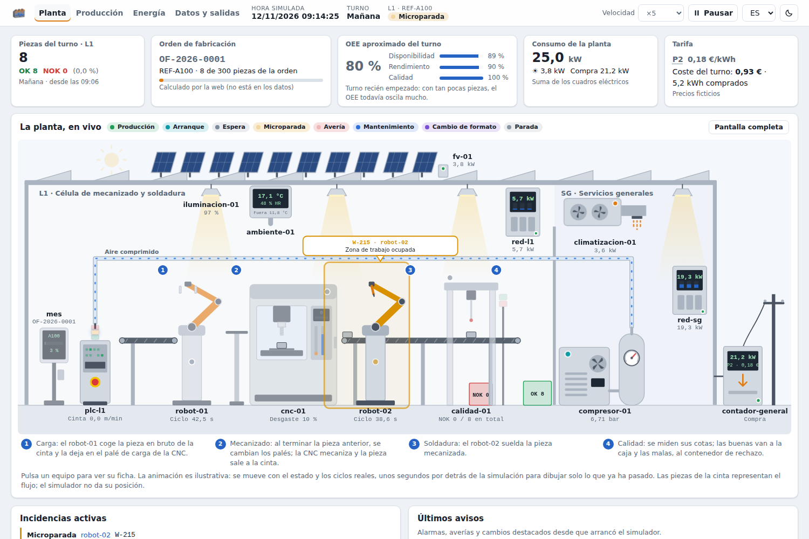
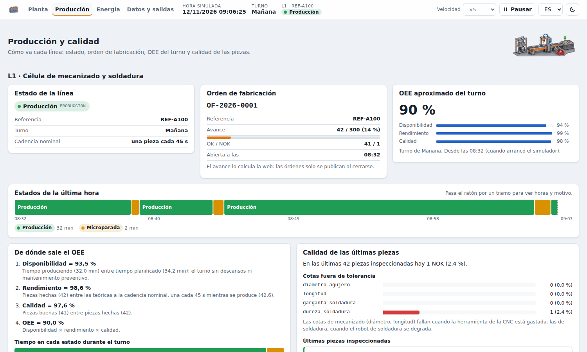
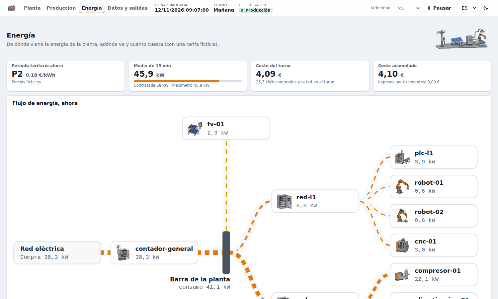

# Simulador de planta


Genera datos sintéticos de una pequeña planta industrial: PLC, robots, CNC, estación de calidad, compresor, consumos eléctricos, fotovoltaica, alarmas, partes de mantenimiento…

Publica los datos en vivo por MQTT y los escribe en ficheros (JSONL, CSV y logs de texto). También genera históricos reproducibles. Sirve para practicar la ingesta, el almacenamiento, la visualización y el análisis de datos industriales, por ejemplo con Python, Node-RED, Logstash, Elasticsearch o InfluxDB.

Todos los datos son inventados. La tarifa eléctrica y los precios son ficticios.

## Qué simula

Una línea de producción (**L1**) y los servicios generales (**SG**):

| Equipo | Qué es |
|---|---|
| `plc-l1` | PLC de la línea: estado, piezas buenas y defectuosas, cinta, neumática |
| `robot-01` | Robot de manipulación (con pinza). Incluye `pinza_cerrada`, una señal que cambia ~160 veces por hora |
| `robot-02` | Robot de soldadura. Se va **degradando** (sube la corriente del eje 3) hasta averiarse cada ~2 semanas |
| `cnc-01` | Centro de mecanizado: husillo, vibración, desgaste y cambios de herramienta |
| `calidad-01` | Estación de inspección: mide **todas las piezas** y publica sus cotas en un mensaje anidado (un array de medidas) |
| `mes` | MES de la línea: órdenes de fabricación con su consumo de materiales y lotes (mensaje anidado). No da telemetría |
| `compresor-01` | Compresor de aire con regulación carga/vacío |
| `climatizacion-01`, `iluminacion-01` | Consumos de la nave |
| `ambiente-01` | Temperatura y humedad de la nave y del exterior |
| `fv-01` | Fotovoltaica de autoconsumo (100 kWp) |
| `red-l1`, `red-sg` | Analizadores de red de los cuadros eléctricos |
| `contador-general` | Contador de la acometida: importación/exportación, periodo tarifario, coste, maxímetro |

Los datos cambian **con criterio**, no al azar:

- **Calendario.** Turnos de mañana (06–14) y tarde (14–22), descansos, fines de semana, festivos y mantenimiento preventivo los viernes.
- **Estados.** Cada equipo tiene una máquina de estados: arranque, producción, microparadas, averías, cambios de formato. Las averías y microparadas son aleatorias, pero solo ocurren mientras se produce.
- **Inercia.** Temperaturas, presión y desgaste evolucionan de forma continua.
- **Relaciones entre variables.** Una avería para la línea, baja el consumo de aire y de energía y genera eventos, logs y un parte. El desgaste de la herramienta aumenta la vibración y las piezas defectuosas, y la estación de calidad muestra qué cota falla.
- **Energía coherente.** Contador general = cuadros + pérdidas − fotovoltaica. Hay consumo base fuera de turno y excesos ocasionales de potencia contratada.
- **Clima.** Sol y temperatura según la hora y la época del año, con días despejados, nubosos y cubiertos.

La descripción completa de cada variable, evento y fichero está en **[docs/formato-datos.md](docs/formato-datos.md)**.

## Requisitos

- **Docker** con Docker Compose (Docker Desktop en Windows o Mac).
- O bien **Python 3.12**, si se ejecuta sin Docker.

## Inicio rápido (Docker)

Desde esta carpeta:

```bash
docker compose up -d
```

Se arrancan dos contenedores:

| Servicio | Dirección | Para qué |
|---|---|---|
| `simulador` | http://localhost:8000 | Interfaz web |
| `mosquitto` | `localhost:1883` | Broker MQTT con los datos en vivo |

Para comprobar que llegan datos (si tienes instalado el cliente `mosquitto_sub`):

```bash
mosquitto_sub -h localhost -p 1883 -t 'fabrica/#' -v
```

**Resultado esperado:** cada 5 s, un mensaje por equipo en `fabrica/L1/plc-l1/telemetria`, `fabrica/SG/compresor-01/telemetria`, etc. De vez en cuando llegan eventos en `.../eventos` y, cada 45 s más o menos (en producción), una pieza inspeccionada en `fabrica/L1/calidad-01/inspecciones`. Cada pocas horas se cierra una orden de fabricación en `fabrica/L1/mes/ordenes`. Además, se van llenando los ficheros de `datos-vivo/` (en vivo no se escribe en `datos/`, que se queda para el histórico).

Para pararlo:

```bash
docker compose down
```

### Si el puerto 8000 o el 1883 está ocupado

Si otro programa ya usa esos puertos, elige otros al arrancar:

```bash
WEB_PUERTO=18000 MQTT_PUERTO=11883 docker compose up -d
```

En Windows (PowerShell): `$env:WEB_PUERTO=18000; $env:MQTT_PUERTO=11883; docker compose up -d`

## Generar un histórico

Para Elasticsearch o el RAG hace falta historia, no solo datos en vivo. Este comando genera 30 días de golpe, con una muestra por minuto:

```bash
docker compose run --rm --no-deps simulador historico --desde 2026-09-01 --dias 30
```

**Resultado esperado** (tarda entre 30 y 60 s según el equipo):

```
... INFO Hecho en 37.2 s: 561600 mensajes de telemetría, 47453 eventos, 59 textos, 22533 inspecciones y 63 órdenes
```

Los 59 textos son 44 notas de turno y 15 partes de mantenimiento. De las 22533 piezas inspeccionadas, 724 son defectuosas. De las 63 órdenes, 49 se cierran completas y 14 por cambio de referencia.

En `datos/` aparecen unos 255 MB, con **una carpeta por equipo** (la misma ruta que su topic MQTT):

```
datos/
├── L1/
│   ├── plc-l1/       telemetria/2026-09-01.jsonl … 2026-10-01.jsonl   eventos/…
│   ├── robot-01/     telemetria/…  eventos/…
│   ├── robot-02/     telemetria/…  eventos/…
│   ├── cnc-01/       telemetria/…  eventos/…
│   ├── calidad-01/   telemetria/…  inspecciones/…
│   ├── mes/          ordenes/…
│   ├── red-l1/       telemetria/…
│   └── textos/       2026-09-01.jsonl …   (partes de mantenimiento y notas de turno)
├── SG/
│   ├── compresor-01/, climatizacion-01/, iluminacion-01/, ambiente-01/, fv-01/, red-sg/   telemetria/…
│   └── contador-general/     telemetria/…  eventos/…
├── energia/   curva-cuartohoraria-2026-09-01.csv …
└── logs/      plc-l1.log, robot-01.log, robot-02.log, cnc-01.log, contador-general.log
```

Así se puede trabajar con un solo origen de datos (por ejemplo, solo el compresor, la estación de calidad o el MES). Para tenerlo todo junto, con un fichero por canal y día (`datos/telemetria/`, `datos/eventos/`…), pon `agrupar: canal` en `salidas.jsonl` de `planta.yaml`.

**Los datos son reproducibles.** Con la misma configuración y el mismo comando, se obtienen exactamente los mismos ficheros. Para que los resultados coincidan entre personas, usad todos el mismo comando (por ejemplo, `--desde 2026-09-01 --dias 30`).

Si ya hay datos en `datos/`, el simulador se niega a mezclarlos. Añade `--sobrescribir` para borrarlos y generar los nuevos.

### Histórico con dato sucio

Para practicar la limpieza del dato, `config/planta-sucio.yaml` es la misma planta con el dato sucio activado (ver [Dato sucio](docs/formato-datos.md#dato-sucio)). Se genera en otra carpeta, `datos-sucios/`, para no tocar `datos/`:

```bash
docker compose run --rm --no-deps simulador --config config/planta-sucio.yaml --salida datos-sucios historico --desde 2026-09-01 --dias 30
```

La simulación es la misma (mismas averías, piezas y textos); solo cambia lo que se escribe. Por eso se puede comparar línea a línea con `datos/`. También es reproducible.

### Histórico y después en vivo

Para tener historia que enlace con el presente y seguir generando en vivo:

```bash
docker compose run --rm --service-ports simulador vivo --historico-dias 7 --sobrescribir
```

Esto no es reproducible, porque depende de la hora a la que se lance.

## Interfaz web

En http://localhost:8000 (solo en modo vivo). En español, euskera e inglés, con tema claro y oscuro.



- **Cabecera (en todas las pantallas):** hora simulada, turno y estado de la línea; **velocidad** (tiempo real o ×10, ×60, ×600, ×3600; con ×600 se ve un turno entero en menos de un minuto) y **pausa**. Si hay una avería en curso, aparece debajo con su cuenta atrás y el botón **Reparar ahora**.
- **Planta:** esquema animado de la nave con todos los equipos e indicadores del turno (piezas, orden de fabricación en curso, OEE aproximado, consumo y tarifa).
  - La animación sigue el proceso de la célula: el robot de manipulación deja la pieza en el palé de carga de la CNC, que es de doble palé; al terminar el mecanizado anterior se cambian los palés; la pieza mecanizada sale a la cinta, la suelda el robot de soldadura y la estación de calidad la mide. Cada movimiento ocurre a la hora de un dato real (ciclos de los robots y de la CNC, llegada de piezas, resultado de la inspección). La animación va unos segundos por detrás de la simulación, para dibujar solo lo que ya ha ocurrido.
  - Los problemas se ven en el equipo que los causa (halo y bocadillo con el código de alarma): averías, microparadas, fuga de aire, presión baja, fallo del inversor, exceso de potencia y la avería anunciada del robot de soldadura. La línea muestra un cartel cuando está parada, en mantenimiento o en cambio de formato.
  - A partir de ×30, un ciclo de máquina dura poco más de un segundo real o menos: el proceso se muestra con ciclos representativos, más lentos, para poder seguirlo. Estados y valores siguen siendo los reales.
- **Ficha de cada equipo** (pulsa el equipo en el esquema): dibujo animado, indicadores, toda su telemetría con los nombres de campo tal como llegan en los datos, evolución en vivo de hasta tres campos (también como tabla), eventos recientes, **cómo leer sus datos** (servidor, puerto y topics MQTT para Node-RED, y carpetas de sus ficheros) e incidencias que se le pueden provocar: avería o microparada (PLC, robots y CNC), fuga de aire (compresor) y fallo del inversor (fotovoltaica).
- **Producción:** estado de cada línea, orden de fabricación en curso, cronología de estados de la última hora, OEE del turno con sus cuentas, cotas fuera de tolerancia, últimas inspecciones y órdenes cerradas con sus materiales y lotes.
- **Energía:** flujo de energía entre la red, el contador general, la fotovoltaica, los cuadros y los equipos; tarifa del día por horas; costes; quién consume ahora; evolución en vivo y de dónde sacar la curva cuartohoraria.
- **Datos y salidas:** qué equipos se envían (los demás se siguen simulando, pero no se publican), qué salidas se usan (MQTT, JSONL, logs y curva CSV), **dato sucio** (nulos, valores absurdos, duplicados, fechas mal formadas…, para practicar la limpieza) y los últimos mensajes tal como se envían.

| Producción y calidad | Energía (tema oscuro) |
|---|---|
|  |  |

El OEE y el avance de la orden en curso los calcula la web: no están en los datos que publica el simulador. Mirar la web no cambia los datos: solo los lee. Lo que sí cambia lo que genera el modo vivo son las acciones que se hacen desde ella (incidencias, velocidad, pausa, equipos y salidas). Los históricos generados por línea de comandos no se ven afectados.

El esquema de la planta se dibuja a partir de `simulador/web/static/plano.json` (posición de cada equipo); un equipo que no esté en el plano aparece igualmente, colocado en su zona. Los dibujos de cada tipo de equipo están en `simulador/web/static/js/equipos/`.

## Uso sin Docker

```bash
python3.12 -m venv .venv
source .venv/bin/activate              # Windows: .venv\Scripts\activate
pip install -r requirements.txt

python -m simulador historico --desde 2026-09-01 --dias 30
python -m simulador vivo                 # web en http://localhost:8000 (MQTT en localhost:1883)
python -m simulador vivo --sin-web --acelerar 60
python -m simulador --help
```

Sin Docker, la salida MQTT necesita un broker en `localhost:1883`. Si no lo hay, el simulador avisa y sigue funcionando con el resto de salidas.

## Opciones de la línea de comandos

| Opción | Modo | Qué hace |
|---|---|---|
| `--config RUTA` | ambos | Fichero de configuración (por defecto, `config/planta.yaml`) |
| `--salida CARPETA` | ambos | Carpeta de datos (por defecto, `datos`) |
| `--desde AAAA-MM-DD` | historico | Primer día (por defecto, hace `--dias` días) |
| `--dias N` | historico | Número de días (30) |
| `--intervalo S` | ambos | Segundos entre muestras (60 en histórico, 5 en vivo) |
| `--sobrescribir` | ambos | Borra los datos generados anteriormente |
| `--acelerar F` | vivo | Factor de aceleración del tiempo (1 = tiempo real) |
| `--historico-dias N` | vivo | Genera N días de histórico antes de empezar |
| `--sin-web` | vivo | Sin interfaz web |
| `--puerto P` | vivo | Puerto de la web dentro del contenedor (8000) |

`--config` y `--salida` van **antes** del modo: `python -m simulador --salida otra-carpeta historico`.

## Configuración

Todo se ajusta en `config/planta.yaml`, sin tocar el código:

- `planta`: semilla, zona horaria, intervalos de muestreo, situación geográfica (para el sol).
- `calendario`: turnos, descansos, días laborables, festivos, mantenimiento preventivo.
- `lineas`: equipos, sus parámetros, fiabilidad (microparadas por hora, horas entre averías, minutos de reparación) y degradación.
- `tarifa`: precios, periodos y potencia contratada (**ficticios**).
- `salidas`: qué salidas se usan, dónde escriben y cómo se agrupan los ficheros JSONL (`agrupar: equipo` o `canal`).
- `dato_sucio`: probabilidades de cada defecto.

Las frases de los textos en lenguaje natural están en `simulador/textos/plantillas.yaml`.

Con Docker, la carpeta `config/` se monta en el contenedor: basta editar el YAML y reiniciar (`docker compose restart simulador`). Si cambias la configuración, los datos dejan de coincidir con los de quien use la configuración original.

## Estructura

```
simulador-planta/
├── docker-compose.yml, Dockerfile, requirements.txt
├── config/            planta.yaml, planta-sucio.yaml, mosquitto.conf
├── docs/              formato-datos.md; img/ (animación y capturas del README, y el script de la animación)
├── simulador/
│   ├── __main__.py    línea de comandos
│   ├── motor.py       bucle histórico / vivo y reparto a las salidas
│   ├── planta.py      crea los equipos y las líneas
│   ├── linea.py       máquina de estados de la línea (simulación por eventos)
│   ├── calendario.py, clima.py, tarifa.py, catalogo.py, dato_sucio.py
│   ├── equipos/       PLC, robot, CNC, inspección, MES, compresor, servicios, medidores de energía
│   ├── salidas/       jsonl, curva_csv, logs, mqtt
│   ├── textos/        generador de partes y notas de turno
│   └── web/           FastAPI (api.py, observador.py) y la interfaz en static/ (HTML, CSS y JavaScript sin dependencias)
└── tests/
```

## Pruebas

```bash
pip install -r requirements-dev.txt
python -m pytest -q                  # todo (unos 60 s)
python -m pytest -q -m "not lento"   # sin el histórico completo de 30 días
```

**Resultado esperado:** `22 passed` (o `21 passed, 1 deselected` sin el lento). Las pruebas de reproducibilidad comprueban que el histórico de referencia (`historico --desde 2026-09-01 --dias 30`) da siempre las mismas cifras y los mismos ficheros, también con la web conectada.

## Problemas frecuentes

- **`address already in use` al arrancar:** el puerto está ocupado. Consulta [Si el puerto 8000 o el 1883 está ocupado](#si-el-puerto-8000-o-el-1883-está-ocupado).
- **No puedo borrar `datos/` (Linux):** los ficheros los crea el contenedor como `root`. Bórralos con `docker compose run --rm --no-deps --entrypoint sh simulador -c 'rm -rf /app/datos/*'`. Otra opción es generar el histórico de nuevo con `--sobrescribir`.
- **`La carpeta datos ya tiene datos`:** usa `--sobrescribir` o elige otra carpeta con `--salida`.
- **La ficha de un equipo dice «Todavía no ha llegado la primera muestra»:** espera unos segundos.
- **La web dice «Sin conexión con el simulador»:** el simulador se ha parado o no está en modo vivo. Mira `docker compose ps` o la terminal donde lo arrancaste.

## Licencia

- **Código:** MIT (ver `LICENSE`).
- **Documentación** (ficheros `.md`): [CC BY-SA 4.0](https://creativecommons.org/licenses/by-sa/4.0/deed.es).
